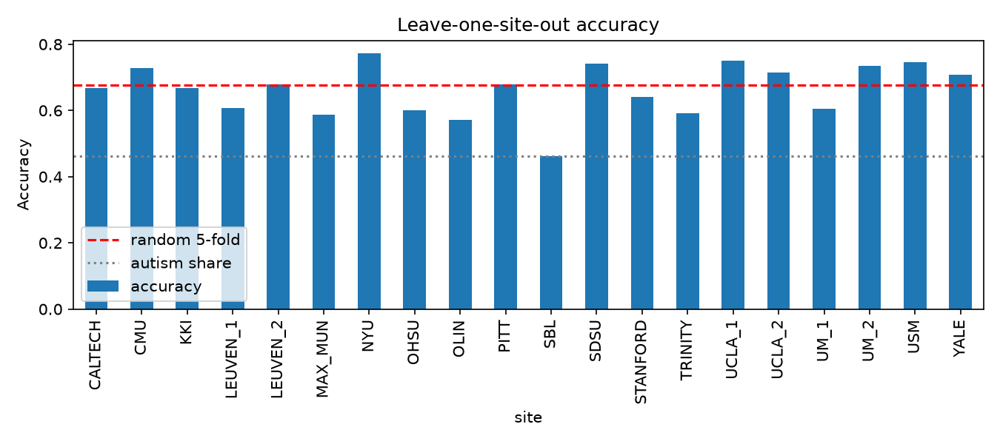

# Abide-connectivity-autism
Exploratory analysis of cross-site generalisation in fMRI connectivity classification of autism (ABIDE), plus a test of whether connectivity-based autism subgroups are stable across scanner sites. Python, nilearn, scikit-learn.

# Cross-site connectivity prediction and subgroup stability in autism (ABIDE)

## Question
Does an fMRI connectivity classifier for autism generalise to scanner sites it has never seen,
and are connectivity-based autism subgroups stable across sites?

## Data
ABIDE I preprocessed fMRI (CPAC pipeline, CC200 atlas), via nilearn. 871 subjects, 20 sites.

## Method
1. Functional connectivity: correlation between the 200 region time series per person.
2. Classifier: standardised features -> L2 regularised logistic regression (C=0.001).
3. Evaluation: random 5-fold cross-validation vs leave-one-site-out.
4. Exploratory: PCA + 2-cluster k-means on autism participants; stability measured by adjusted Rand index across random site splits; chi-square test of cluster vs site.

## Results
| Evaluation | Accuracy | AUC |
|---|---|---|
| Random 5-fold | 0.676 | 0.741 |
| Leave-one-site-out (mean) | 0.662 | 0.742 |

Subgroup stability (ARI): 0.791 | Cluster vs site, chi-square p: 9.85e-04

## Interpretation
Leave-one-site-out performance remains remarkably stable compared to random 5-fold cross-validation (AUC 0.742 vs 0.741), indicating robust regularisation against overfitting to individual scanners. However, the exploratory subtyping analysis reveals high internal stability (ARI 0.791) alongside a significant site confound (chi-square p < 0.001), highlighting that scanner-specific variance still influences unsupervised clustering.

## Limitations
Preprocessed data only; one atlas (CC200) and one pipeline; simple linear models; no site harmonisation applied yet; no clinical claims. Subgroup analysis is exploratory and inspired by published cross-species subtyping work, not a replication.

## Next steps
Site harmonisation using ComBat, evaluation across alternative atlases (e.g., Schaefer 400), and cortical gradient analysis.